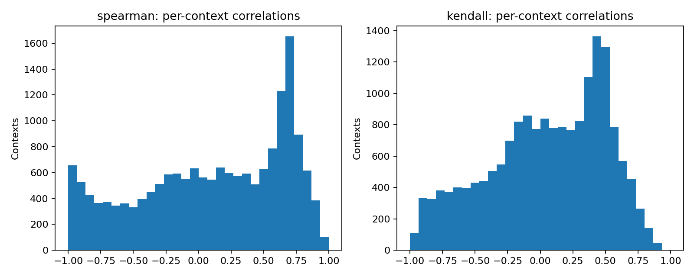

# Frostbite critic 정렬 점수

평가 문맥 17,421개, 에피소드 20개, 블록 320개.
Bootstrap: episode 단위 재표집 10,000회, percentile 95% CI, seed=2027.

| 상관계수 | 평균 | 95% CI | 정의 불가 문맥 |
|---|---:|---|---:|
| spearman | 0.1076 | [0.0838, 0.1315] | 0 |
| kendall | 0.0521 | [0.0320, 0.0722] | 0 |

CI는 한 고정 체크포인트의 평가 문맥에 대한 불확실성이며 학습 시드 간 변동은 포함하지 않습니다.
상수 예측의 상관계수는 정의 불가로 제외합니다. 유효 재표집 단위가 2개 미만이면 CI를 계산하지 않습니다.

