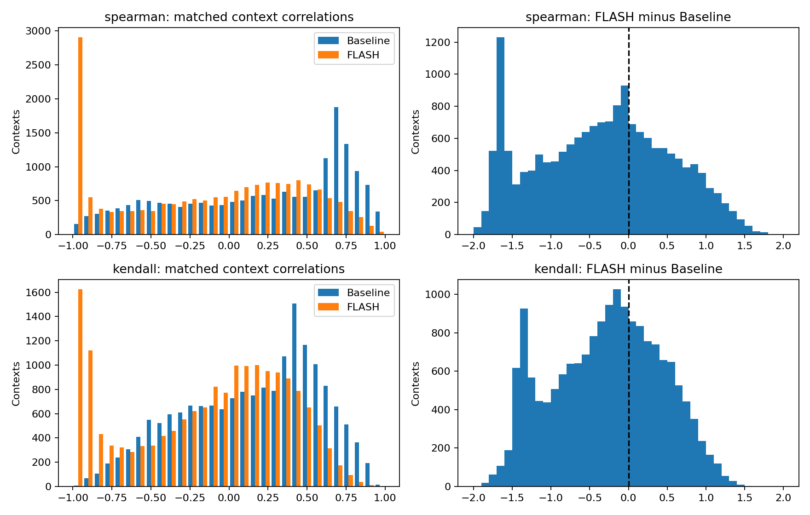

# Frostbite 가치 함수 비교

평가 프레임 17,421개, 에피소드 20개, 블록 320개.
Bootstrap: episode 단위 paired 재표집 10,000회, percentile 95% CI, seed=2027.

| 상관계수 | Baseline 평균 [95% CI] | FLASH 평균 [95% CI] | 차이 [95% CI] |
|---|---:|---:|---:|
| spearman | 0.2100 [0.1743, 0.2476] | -0.1287 [-0.1548, -0.1023] | -0.3387 [-0.3698, -0.3082] |
| kendall | 0.1476 [0.1215, 0.1746] | -0.1332 [-0.1540, -0.1119] | -0.2807 [-0.3036, -0.2582] |

평균 차이가 절대 효과 크기입니다. 차이의 CI가 0을 포함하는지로 통계적 불확실성을 확인합니다.
이 구간은 두 고정 체크포인트의 평가 문맥에 대한 불확실성입니다. 학습 시드 간 변동을 포함하지 않습니다.
에피소드 수도 작다면 신뢰구간을 탐색적으로 해석하세요. 유효 재표집 단위가 1개뿐이면 CI를 계산하지 않습니다.
block을 선택하면 블록 사이의 의존성은 반영하지 못합니다. 기본값 episode를 권장합니다.

| 지표 | Baseline 중앙값 [Q1, Q3] | FLASH 중앙값 [Q1, Q3] | 차이 중앙값 [Q1, Q3] | FLASH 개선 비율 | 제외 쌍 |
|---|---:|---:|---:|---:|---:|
| spearman | 0.3358 [-0.2495, 0.6990] | -0.0441 [-0.7010, 0.3701] | -0.2963 [-1.0369, 0.3040] | 36.2% | 0 |
| kendall | 0.2206 [-0.1912, 0.4853] | -0.0369 [-0.5535, 0.2731] | -0.2321 [-0.8194, 0.2500] | 36.8% | 0 |

한 평가 문맥은 동일한 관측·행동 이력에 이글루 17단계 변형을 적용한 한 평가 시점입니다.
예측이 상수인 경우 상관계수는 정의되지 않습니다. 해당 비교 쌍을 제외하며 0으로 대체하지 않습니다.
개별 값과 정의 불가 개수는 per_context_correlations.csv 및 statistics.json에 저장합니다.
평균 개선이 관찰되더라도 절대 상관계수의 크기를 함께 해석해야 하며, 이 결과만으로 공간적 얽힘의 원인이나 해소를 입증하지 않습니다.

