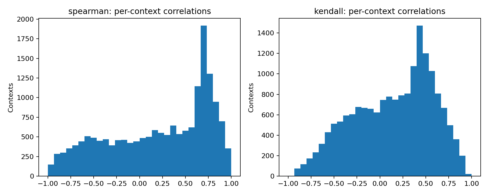

# Frostbite 단일 모델 정렬 점수

Run: `Frostbite-life_done-wm_2L512D8H-100k-seed6000_X`

평가 문맥 17,421개, 에피소드 20개, 블록 320개.
Bootstrap: episode 단위 재표집 10,000회, percentile 95% CI, seed=2027.

| 집계 방식 | Spearman ρ [95% CI] | Kendall τ_b [95% CI] |
|---|---:|---:|
| 문맥별 상관의 평균 | 0.2102 [0.1744, 0.2477] | 0.1478 [0.1216, 0.1747] |
| 전역 평균 프로파일의 상관 | 0.3039 [0.0025, 0.6765] | 0.2353 [0.0000, 0.5441] |

문맥별 상관의 평균은 상관계수가 정의되는 문맥만 포함합니다. 상수 예측을 0으로 대체하지 않습니다.
전역 프로파일은 모든 문맥의 단계별 값을 평균합니다. 각 bootstrap에서도 프로파일을 다시 평균한 뒤 상관을 계산합니다.
상수 프로파일인 bootstrap 표본은 CI에서 제외하며 그 횟수를 statistics.json에 기록합니다.
CI는 고정 체크포인트의 평가 문맥에 대한 불확실성이며 학습 seed 간 변동은 포함하지 않습니다.
유효 재표집 단위가 2개 미만이면 해당 CI를 계산하지 않습니다. 공유 데이터의 수집 출처는 protocol.json에 기록합니다.

